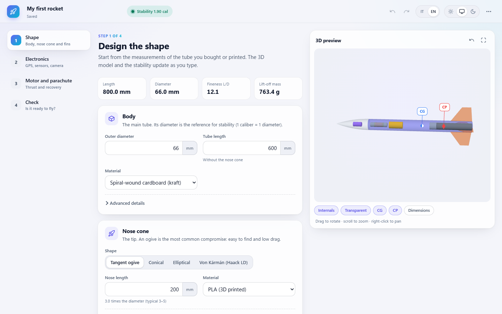

<div align="center">

# 🚀 Rocket Design Assistant

**Design a hobby rocket in your browser and check, step by step, whether it is ready for its first flight.**


[](LICENSE)

**[Open the app →](https://thestevendev.github.io/rocket-design-assistant/)** · English / Italiano



</div>

> [!WARNING]
> The results are **simplified estimates for preliminary design**, not a flight certification.
> Always run a full simulation (e.g. OpenRocket), do a swing test and follow the rules of your launch site and club.

## About

Rocket Design Assistant is a single-page web app for single-stage hobby rockets. You enter the body, nose cone and fins, pick electronics, motor and parachute, and the app estimates mass, centre of gravity (CG), centre of pressure (CP) and static margin while showing the rocket in 3D.

Everything runs in the browser: there is no server, no account and no data sent anywhere. Projects are saved in your browser's local storage and can be exported as JSON files.

## Features

**Guided mode (4 steps)**
- **Shape** — body tube, nose cone (6 profiles) and trapezoidal fins, with a live fin sketch
- **Electronics** — catalog of typical GPS modules, IMUs, barometer, flight computers, cameras and batteries, with weight and battery-runtime estimates
- **Motor and parachute** — common motor classes (C to H) filtered by tube size, thrust-to-weight ratio, parachute size and descent rate
- **Check** — a first-flight checklist (stability, thrust, recovery, power, GPS antenna, sensors) with links to where each issue can be fixed

**Expert mode**
- Detailed mass table with measured / estimated / computed sources and uncertainties
- Barrowman CP breakdown, static margin during the burn and custom mass configurations
- Sensitivity analysis: tornado chart and Monte Carlo distribution of the static margin
- Fin structure data sheet (fabrication constraints, material properties) and background on fin flutter

**Everywhere**
- Interactive 3D preview with CG/CP markers, internals and dimensions
- Undo / redo, autosave, multiple projects, JSON import / export
- Units in mm, cm or m and g or kg; light, dark or system theme
- Interface in **English** (default) and **Italian**

## Tech stack

| Area | Tools |
|---|---|
| Language | TypeScript |
| UI | React 19, plain CSS, hand-drawn SVG charts |
| 3D | Three.js |
| State | Zustand (with undo / redo) |
| File validation | Zod |
| Build and tests | Vite 8, Vitest |

## Run it locally

### Requirements

- [Node.js](https://nodejs.org/) **22.12 or newer** (it includes `npm`)
- [Git](https://git-scm.com/) to clone the repository (or download the ZIP from the green **Code** button)

No environment variables, API keys or external services are needed.

### Steps

1. Clone the repository:
   ```bash
   git clone https://github.com/TheStevenDev/rocket-design-assistant.git
   ```
2. Move into the app folder:
   ```bash
   cd rocket-design-assistant/app
   ```
3. Install the dependencies (uses the exact versions in `package-lock.json`):
   ```bash
   npm ci
   ```
4. Start the development server:
   ```bash
   npm run dev
   ```
5. Open the address printed in the terminal (usually <http://localhost:5173>).


## Deployment

The site is published on **GitHub Pages** by the workflow in [`.github/workflows/deploy-pages.yml`](.github/workflows/deploy-pages.yml). On every push to `main` it installs the dependencies, runs the tests, builds `app/` and deploys `app/dist`.

To use it on your own fork:

1. Push the repository to GitHub.
2. Open **Settings → Pages** and set **Source** to **GitHub Actions**.
3. Push to `main` (or run the workflow from the **Actions** tab). The site appears at `https://<your-username>.github.io/<repository-name>/`.

The build uses relative paths (`base: './'` in `vite.config.ts`), so it works under any sub-path without changes.

## Project structure

```text
.
├── app/                     The web application
│   ├── src/
│   │   ├── core/            Types, units, materials, parts catalog, translations
│   │   ├── geometry/        Nose profiles, derived body and fin geometry
│   │   ├── mass/            Structural masses, components, CG
│   │   ├── physics/         Barrowman CP, static margin, sensitivity, fin data
│   │   ├── analysis/        analyzeProject() and the first-flight checks
│   │   ├── validation/      Field and project validation
│   │   ├── io/              JSON import / export, browser storage
│   │   ├── state/           Zustand store (undo / redo, preferences)
│   │   ├── viewer/          Three.js scene
│   │   └── ui/              React components
│   ├── index.html
│   └── package.json
├── docs/                    Design notes (Italian) and screenshot
└── .github/workflows/       GitHub Pages deployment
```

The calculation modules (`core` → `analysis`) are pure TypeScript with no React or Three.js imports, so they are tested in Node.

## Known limitations

- **Simplified physics.** The Barrowman method assumes subsonic flow, small angles of attack, no body lift, no transitions or boattail and one set of trapezoidal fins. Compressibility (above roughly Mach 0.3), wind and gusts are not modelled.
- **No trajectory simulation** and **no flutter or structural calculation**. The fin section only collects data.
- **Catalog values are indicative.** Weigh the real parts and check motor data on [thrustcurve.org](https://www.thrustcurve.org).
- **Projects live in one browser.** Clearing the site data deletes them: use **Export file** to keep a copy.
- The 3D preview needs **WebGL**. Without it, the rest of the app still works.

## Troubleshooting

| Problem | Fix |
|---|---|
| `npm` or `node` is "not recognized" | Install Node.js, then close and reopen the terminal (and VS Code) |
| `npm ci` complains about the Node version | Update Node.js to 22.12 or newer |
| Port 5173 is already in use | Vite picks the next free port: use the address it prints |
| The 3D preview stays empty | Enable hardware acceleration in the browser or try another browser |
| A project disappeared | Projects are per browser and per site: open the same browser on the same address, or import an exported file |

## License

Released under the [MIT License](LICENSE).

---

